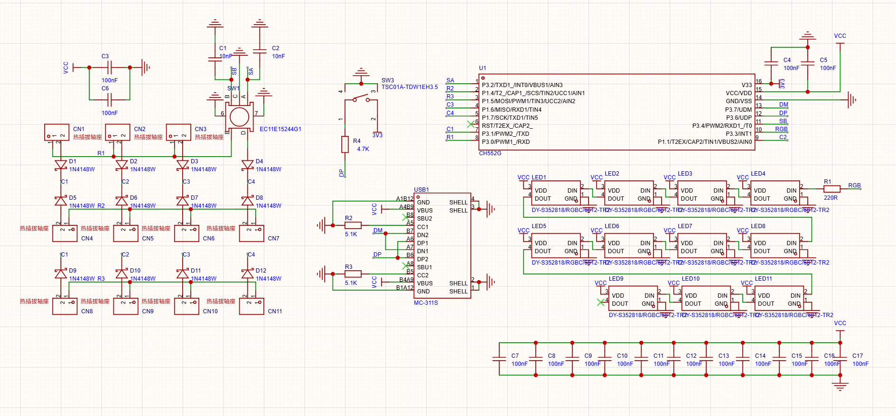

# MineKey

CH552G 做的 11 键 + EC11 旋钮小键盘。原理图、外壳模型、固件、烧录工具都在这里。



## 硬件

| | |
|---|---|
| 主控 | CH552G，SOP-16，24 MHz，16 KB Flash / 1 KB xRAM |
| 矩阵 | 3 行 × 4 列，行准双向输入 + 列推挽拉低，每键串 1N4148 |
| 旋钮 | EC11，A = P3.2，B = P3.4，按压接在矩阵 R1C4 |
| 灯珠 | 11 颗 WS2812，数据脚 P3.3 |
| 接口 | Type-C，D+ = P3.6，D− = P3.7，内部 1.5 k 上拉 |

ROW1 是上排、ROW3 是下排，COL1–COL4 从左到右。灯珠蛇形串联：
`CN11 → CN10 → CN9 → CN5 → CN6 → CN7 → CN8 → CN4 → CN3 → CN2 → CN1`。
引脚定义见 `firmware/src/board.h`。

## 目录

```
hardware/    原理图 jpg、嘉立创工程 epro2、外壳与键帽 STEP、CH552 数据手册
firmware/    src/ 固件源码，build.bat 构建脚本，release/ 现成 hex
tools/       flash_cli.bat 烧录，ispprog/ 烧录器源码，verify_hex.py 校验
docs/        01 改板记录，02 协议，04 调试记录
```

## 制作

1. 打板：`hardware/keyboard_v1.epro2` 导入嘉立创 EDA。改板要点在 `docs/01-原理图审查.md`。
2. 外壳：`keyboard-Body.step` 是主体，`keyboard-CAP-full.step` 是 11 颗键帽，直接导入切片软件。
3. 焊接：轴座、WS2812、EC11、Type-C。灯珠方向按丝印，串错一颗后面全不亮。
4. 烧录：见下。
5. 改键：用配置器插上就能改，不用重新烧。

## 烧录

双击 `tools\flash_cli.bat`，默认烧 `firmware\release\minekey_led.hex`，也可以把其它 hex 拖上去。

1. 关掉 WCHISPStudio / WCHISPTool，它们会独占 HID 设备
2. 板子拔插一次，停在 BootLoader
3. 运行 `flash_cli.bat`
4. 再拔插一次，枚举成 `1209:0001` 就是成功了

从源码编译：

```bash
cd firmware
build.bat                          # 需要 SDCC
python ../tools/verify_hex.py release/minekey.hex
```

地址必须小于 `0x3800`，越界会覆盖 BootLoader。

## 默认键位

| 排 | 第 1 列 | 第 2 列 | 第 3 列 | 第 4 列 |
|---|---|---|---|---|
| 上 | CN9 = 9 | CN10 = 0 | CN11 = Backspace | 旋钮 |
| 中 | CN5 = 5 | CN6 = 6 | CN7 = 7 | CN8 = 8 |
| 下 | CN1 = 1 | CN2 = 2 | CN3 = 3 | CN4 = 4 |

旋钮顺时针音量 +、逆时针音量 −、按下静音。出厂灯效呼吸 30% `#F77634`。
长按旋钮 3 秒进 BootLoader。

## 协议

| Report ID | 方向 | 长度 | 用途 |
|---|---|---|---|
| 1 | IN | 8 | 键盘，修饰键 + 6 键 |
| 2 | IN | 2 | 多媒体 |
| 3 | IN | 9 | 状态，矩阵位图 + 旋钮刻度 |
| 4 | IN | 5 | 鼠标，按键 + X/Y + 滚轮 |
| 5 | IN | 1 | 主机动作编号 |
| 0x10 | Feature | 64 | 配置通道 |

功能码：`0x01xx` 普通键、`0x02xx` 多媒体、`0x03xx` 鼠标、`0x04xx` 灯效、`0x5MKK` 组合键、
`0x06xx` 主机动作、`0x07XY` 光标移动（X 速度档，Y 方向）。细节见 `docs/02-软件架构与协议.md`。

## 注意

- WCHISPStudio 的「下载」会先写配置位，部分芯片会卡在「配置位校验失败」。这时代码区还没被碰、芯片是好的，重试或换回 GUI 都能继续。
- `tools/ispprog` 依赖 WCH 的 DLL，不在仓库里，需从 WCHISPTool 安装目录拷贝，说明见 `tools/ispprog/README.md`。

## 许可

GPL-3.0，见 [LICENSE](LICENSE)。
