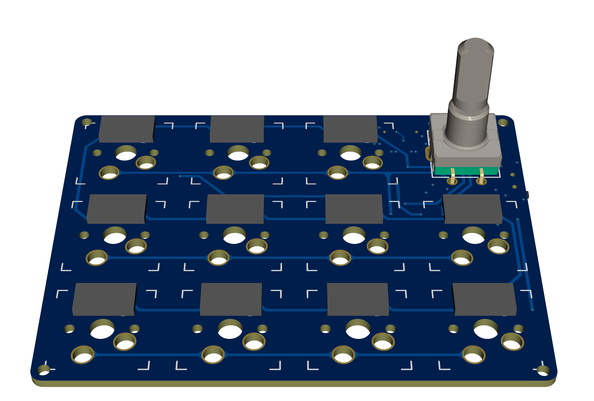
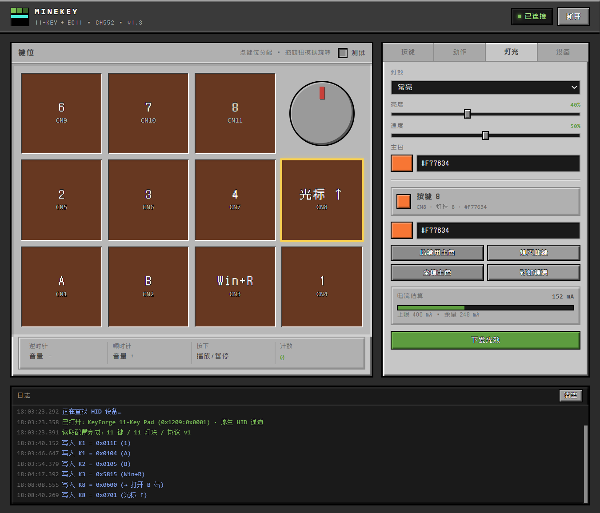

# MineKey · CH552 十一键 + EC11 旋钮键盘

> 一颗 CH552G，做成一把能自定义键位、带 11 颗 WS2812、能在电脑上改键的机械键盘。
> 原理图、固件、配置器、主机动作代理齐全，**已全部在真机跑通**（USB 枚举 / 按键 / 灯光 / 改键 / 落盘均实测）。



---

## 特性

- **11 键 + 1 旋钮**：3×4 矩阵（第 12 位是旋钮按压），每键二极管隔离，6 键无冲
- **USB HID 复合设备**：键盘 + 多媒体 + 鼠标 + 厂商自定义通道（一个接口，四个集合）
- **网页 / 桌面双形态配置器**：改键、改灯、改旋钮，走 HID Feature Report，**不用重烧固件**
- **配置存 DataFlash**：断电保留，「恢复出厂」一键还原
- **11 颗 WS2812**：8 种灯效（常亮/呼吸/彩虹/按压缩放/关闭/彩虹呼吸/单点扫描/星光），带 400 mA 电流限幅
- **主机动作**：按键可让电脑开网页、开软件、开文件夹、执行命令（HID 发编号，电脑端代理执行）
- **救援后门**：长按旋钮 3 秒无条件跳回 BootLoader，固件跑飞也能重烧

---

## 配置器界面



左边是键位图（点一下选中，右边跟着切），右边分「按键 / 动作 / 灯光 / 设备」四页；
底部是实时日志，每次读写都会打印出来。改完不用重烧，直接写进键盘的 DataFlash。

> 截图为调试过程中的自定义键位，出厂默认见下方「[默认键位](#默认键位)」。

---

## 硬件

| 项目 | 说明 |
|---|---|
| 主控 | CH552G（SOP-16，E8051，24 MHz，16 KB Flash / 1 KB xRAM） |
| 矩阵 | 3 行 × 4 列，行准双向输入 + 列推挽拉低，每键串 1N4148 |
| 旋钮 | EC11 编码器（A = P3.2，B = P3.4，按压在矩阵 R1C4） |
| 灯珠 | 11 颗 WS2812 蛇形串联，数据脚 P3.3 |
| 接口 | USB 2.0 全速，D+ = P3.6，D− = P3.7（内部 1.5 k 上拉，无需外部电阻） |

引脚表见 `firmware/src/board.h` 顶部注释；改板核对记录见 `docs/01-原理图审查.md`。

**接线映射（踩过坑，勿随意改）**：`ROW1 = 上排`、`ROW3 = 下排`，`COL1..COL4` 左→右。
灯珠串联是蛇形：`CN11 → CN10 → CN9 → CN5 → CN6 → CN7 → CN8 → CN4 → CN3 → CN2 → CN1`。

---

## 目录结构

```
Keyboard/
├── README.md
├── MineKey.bat                 桌面配置器启动器（首次会自动构建）
├── firmware/                   CH552 固件（SDCC / 8051）
│   ├── src/
│   │   ├── app.c               矩阵扫描、去抖、灯效、配置存取、Feature 协议
│   │   ├── usb.c               USB 描述符与端点（含 HID 报告描述符）
│   │   ├── board.h             板级定义：引脚、矩阵尺寸、默认键位 / 灯效
│   │   ├── ch552.h             寄存器定义
│   │   └── app.h / usb.h
│   ├── test/                   主机侧单元测试桩
│   ├── build.bat               一键构建（需要 SDCC）
│   ├── Makefile
│   └── release/                现成固件
│       ├── minekey.hex         无灯安全版
│       ├── minekey_led.hex     完整版，带灯效（推荐）
│       ├── minekey_diag.hex    诊断版：烧入后点两颗红灯做里程碑
│       └── minekey.bin
├── tools/
│   ├── configurator/           配置器前端（纯 HTML/JS，浏览器可直接打开）
│   ├── configurator-win/       桌面版外壳（C# + WebView2，HID 走原生 API）
│   ├── host-agent/             主机动作代理（Python + hidapi）
│   ├── ispprog/                命令行烧录器源码（需自备 WCH 官方 DLL，见其 README）
│   ├── flash_cli.bat           安全烧录入口（绝不修改配置位）
│   ├── set_keymap.py           命令行改键位（写 DataFlash，不重烧）
│   ├── set_led.py              命令行改灯效
│   ├── verify_hex.py           hex 结构校验（地址范围 / 校验和 / 与 bin 比对）
│   └── hidtest.ps1             Feature 通道往返测试
├── docs/
│   ├── 01-原理图审查.md        改板核对记录（P1–P4）
│   ├── 02-软件架构与协议.md    报文格式、功能码表、协议细节
│   ├── 03-使用说明.md          面向使用者的完整说明
│   └── 04-固件校验报告.md      每版固件的校验数据 + 真机调试过程
├── hardware/
│   ├── Keyboard_sch.pdf        原理图
│   ├── Keyboard.epro2          嘉立创 EDA 工程
│   ├── keyboard.png            板图
│   └── CH552DS1.PDF            WCH 官方手册
└── assets/                     图标源文件
```

---

## 快速开始

### 1. 烧固件

需要 **SDCC**（`sdcc` + `packihx` + `makebin`）和一根直连主板的 USB 线。

**推荐 `tools\flash_cli.bat`**：双击即烧 `release\minekey_led.hex`，也可把其它 hex 拖到它上面。

它调用 WCH 官方命令行烧录器，走 `noprotect` 模式 —— **只擦写代码区，绝不碰配置位/保护位**。

> ⚠️ 先关掉 WCHISPStudio / WCHISPTool，它们会独占 HID 设备，导致命令行报 `FlashProgramB -> 0`。

烧完工具不会让芯片自动运行，**拔插一次 USB** 即可。

### 2. 用配置器

双击根目录 **`MineKey.bat`**（首次运行自动 `dotnet build`，需要 .NET SDK）。
不想装 .NET 就用浏览器打开 `tools/configurator/index.html`（WebHID，Chrome / Edge 均可）。

能做的事：改键位、改灯效（8 种模式 + 每颗独立颜色）、改旋钮三向动作、导出 / 导入配置。

### 3. 主机动作（让键开网页 / 开软件）

```bash
cd tools/host-agent
pip install hidapi
python agent.py            # 或双击 start_agent.bat
```

然后在配置器「动作」页填槽位 → 按键页把某个键设成「主机动作 + 槽位号」。

**代理窗口关掉 = 主机动作失效**，这是设计如此：键盘只发动作编号，执行必须靠电脑上的进程。

---

## 默认键位

| 排 | 第 1 列 | 第 2 列 | 第 3 列 | 第 4 列 |
|---|---|---|---|---|
| 上排 | CN9 = **9** | CN10 = **0** | CN11 = **Backspace** | 旋钮 |
| 中排 | CN5 = **5** | CN6 = **6** | CN7 = **7** | CN8 = **8** |
| 下排 | CN1 = **1** | CN2 = **2** | CN3 = **3** | CN4 = **4** |

旋钮：顺时针 音量 +、逆时针 音量 −、**按下 静音**。
出厂灯效：呼吸 / 亮度 30% / `#F77634` 全填。

改键位不用重烧：`python tools/set_keymap.py`（写 DataFlash 并回读校验）。

---

## 协议速查

一个 HID 接口、四个集合，用 Report ID 区分：

| Report ID | 方向 | 长度 | 用途 |
|---|---|---|---|
| 1 | IN | 8 | 键盘（修饰键 + 6 键） |
| 2 | IN | 2 | 多媒体（Consumer usage 16 位） |
| 3 | IN | 9 | 状态（矩阵位图 + 旋钮刻度） |
| 4 | IN | 4 | 鼠标（按键 + 滚轮） |
| 5 | IN | 1 | 主机动作编号 |
| 0x10 | Feature | 63 | 配置通道（命令 + 参数） |

功能码编码：`0x01xx` 普通键、`0x02xx` 多媒体、`0x03xx` 鼠标、`0x04xx` 灯效动作、
`0x5MKK` 组合键（M = 修饰位）、`0x06xx` 主机动作、`0x07xx` 光标相对移动。

Feature 负载是 **63 字节**（+ 报告 ID = 64，正好卡在 EP0 单包上限），控制传输不分包。

完整帧格式见 [`docs/02-软件架构与协议.md`](docs/02-软件架构与协议.md)。

---

## 已知坑（都踩过了，改代码前先看）

1. **别用 WCHISPStudio 的「下载」烧这块板**
   它流程是「写配置位 → 擦除 → 编程」，配置位那步在不少 CH552 上会失败并中止；
   反复重试会把芯片拖进异常状态。用 `tools/flash_cli.bat`（`noprotect`）绕开。
2. **拿 `0` 当哨兵值的地方**
   `host_action_pending == 0` 曾被当成"没有待发动作"，导致**槽位 0 永远发不出报文**
   （表现为"文件夹能用、开网页没反应"）。已改用 `0xFF`。
3. **动作 / 主机动作必须占住 `active_sw`**
   否则"按下沿"判定失效，按住不放会每 1 ms 触发一次（主机动作狂发）。
4. **`writeEnc()` 写完必须 `SAVE`**
   只写 RAM 的话界面显示成功、拔电回旧值 —— 看起来像"根本改不了"。
5. **动作表有两份**：配置器存 localStorage，代理读 `actions.json`。
   桌面版改完会自动写 json（`writeActions` 桥命令），网页版仍需手动导出。

---

## 开发

```bash
cd firmware
build.bat            # 需要 SDCC，产物落在 firmware/ 根目录
```

固件在 16 KB Flash 里占约 9.5 KB（`0x0000–0x2558`），用户区上限 `0x3800`（之后是 BootLoader）。
构建后建议校验一次：

```bash
python tools/verify_hex.py firmware/release/minekey.hex
```

它会核对校验和、地址范围（**必须 < 0x3800**，越界会覆盖 BootLoader）以及与 bin 的一致性。

---

## 文档

| 文档 | 内容 |
|---|---|
| [01-原理图审查](docs/01-原理图审查.md) | 改板问题核对（编码器电容、D+ 上拉、灯珠去耦…） |
| [02-软件架构与协议](docs/02-软件架构与协议.md) | 报文格式、功能码、配置结构 |
| [03-使用说明](docs/03-使用说明.md) | 面向使用者的完整操作手册 |
| [04-固件校验报告](docs/04-固件校验报告.md) | 每版固件的校验数据与真机调试记录 |

---

## 授权

本项目以 **GNU General Public License v3.0** 发布，详见 [LICENSE](LICENSE)。

`tools/ispprog/` 调用的 WCH 官方 ISP 动态库（`WCH55xISPDLL.dll` 等）版权归南京沁恒微电子，
**不包含在本仓库内**，需自行从 WCHISPTool 安装目录获取，编译方法见
[`tools/ispprog/README.md`](tools/ispprog/README.md)。

字体 [Zpix 最像素](https://github.com/SolidZORO/zpix-pixel-font) 遵循其自身授权。
